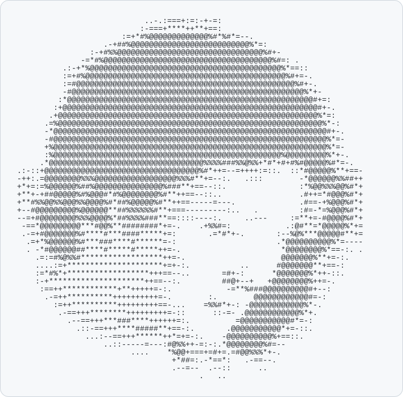

<p align="center">
  
</p>

<h3 align="center">Ruijie Zheng</h3>

<p align="center">
  Computer Science at the University of Michigan · HCI, vision-language-action models, LLM security<br>
  I build open-source tools that make AI agents' work checkable.
</p>

<p align="center">
  <a href="https://ruijiezh67.github.io">Website</a> ·
  <a href="https://ruijiezh67.github.io/#publications">Publications</a> ·
  <a href="https://www.linkedin.com/in/ruijie-zheng-51ba9b381/">LinkedIn</a> ·
  Ann Arbor, MI
</p>

---

#### Open source

| | |
|---|---|
| **[ruijie_skills](https://github.com/ruijiezh67/ruijie_skills)** | Claude Code skills, each aimed at a failure measured in real agent runs. **notary** gives every reported number a checkable receipt; **decoy** makes fake test data that can't be mistaken for real. Also shift-change (session handovers), runcard and runway. |
| **[modfence](https://github.com/ruijiezh67/modfence)** | See a project as modules and prompt your coding agent about one of them; edits outside the module are blocked. |
| **[can-an-agent](https://github.com/ruijiezh67/can-an-agent)** | Small, sourced experiments on what AI agents can and can't do: can an agent close the books, and can it post on 26 platforms. |

**Contributions:** the notary and decoy agent skills to [awesome-llm-apps](https://github.com/Shubhamsaboo/awesome-llm-apps) ([#1270](https://github.com/Shubhamsaboo/awesome-llm-apps/pull/1270), [#1271](https://github.com/Shubhamsaboo/awesome-llm-apps/pull/1271)), after three rounds of maintainer review.

#### Research code

- **[VLA_tasks](https://github.com/ruijiezh67/VLA_tasks)**: backdoors in vision-language-action models that fire only under a physical deployment condition.
- **[LRM_colab_tasks](https://github.com/ruijiezh67/LRM_colab_tasks)**: experiments on latent reasoning models (CoLaR, LT-Tuning, Latent-SFT, Coconut).

<details>
<summary>The portrait as plain text</summary>

```text
                            ..-.:===+:=:-+-=:
                           :-===+****++**+==:
                       :=+*#%@@@@@@@@@@@@@%#*%#*=--.
                   .-+##%@@@@@@@@@@@@@@@@@@@@@@@@@@%*=:
                :-+#%%@@@@@@@@@@@@@@@@@@@@@@@@@@@@@@@@%#+-
              -=*#%@@@@@@@@@@@@@@@@@@@@@@@@@@@@@@@@@@@@@%#=: .
          .:-+*%@@@@@@@@@@@@@@@@@@@@@@@@@@@@@@@@@@@@@@@@@@%*==::
          :=+#%@@@@@@@@@@@@@@@@@@@@@@@@@@@@@@@@@@@@@@@@@@@@%#+=-.
          :=#@@@@@@@@@@@@@@@@@@@@@@@@@@@@@@@@@@@@@@@@@@@@@@@@%#+-.
          -#@@@@@@@@@@@@@@@@@@@@@@@@@@@@@@@@@@@@@@@@@@@@@@@@@@@%*+-
         :*@@@@@@@@@@@@@@@@@@@@@@@@@@@@@@@@@@@@@@@@@@@@@@@@@@@@@@#+=:
        :+@@@@@@@@@@@@@@@@@@@@@@@@@@@@@@@@@@@@@@@@@@@@@@@@@@@@@@@@#+-.
       .+@@@@@@@@@@@@@@@@@@@@@@@@@@@@@@@@@@@@@@@@@@@@@@@@@@@@@@@@@%*=:
      .=%@@@@@@@@@@@@@@@@@@@@@@@@@@@@@@@@@@@@@@@@@@@@@@@@@@@@@@@@@@%*-:
      -*@@@@@@@@@@@@@@@@@@@@@@@@@@@@@@@@@@@@@@@@@@@@@@@@@@@@@@@@@@@@#+-.
      -#@@@@@@@@@@@@@@@@@@@@@@@@@@@@@@@@@@@@@@@@@@@@@@@@@@@@@@@@@@@@%*=-
      +%@@@@@@@@@@@@@@@@@@@@@@@@@@@@@@@@@@@@@@@@@@@@@@@@@@@@@@@@@@@@%*=-
      :%@@@@@@@@@@@@@@@@@@@@@@@@@@@@@@@@@@@@@@@@@@@@@@@@@@%@@@@@@@@@%*+-.
     .*@@@@@@@@@@@@@@@@@@@@@@@@@@@@@@@@@@%%%%###%%@%%+*#*+#+#%#@@@@@%#*=-.
.:-::+@@@@@@@@@@@@@@@@@@@@@@@@@@@@@@@@@@%#*++=--=++++:=::.  ::*#@@@@@%**+==-
-++:.=@@@@@@@@%%%@@@@@@@@@@@@@@@@@@%%%#**+=--:.   .:::        -*@@@@@@%%##++
+*+=:=%@@@@@@%##%@@@@@@@@@@@@@@@%###**+==--::.                :*%@@%%%@@%#*+
+**+-+##@@@@@%#%@@@#*#%@@@@@@@@%#**++==--::..                 .#++=*#@@@%#*+
+**#%%@@%%@@@%%@@@@%#*##%@@@@@%#**++==-----=---.              .#==-+%@@@%#*+
+--#@@@@@@@@@%@@@@@@**##%%%%%%#**+===---------:..   .         :#=-*=%@@@%#*+
--=+#@@@@@@@@%%%@@@@%*##%%%%###**==::::----:.     ..---     :=**+=-#@@@@%#*+
 -==*@@@@@@@@@***#@@%**########*+=-.    .+%%#=:            .:@#**=*@@@@@%*+=
 .-=+#@@@@@@@%#****#***####*****+=:       .=*#*+-.       :--%@%***@@@@@#**+=
  .=+*%@@@@@@%#***###****#******=-:                      .*@@@@@@@@@@%*=----
  . -*#@@@@@@##****#*****#*****++=-.                      *@@@@@@@@%*==-:. .
    .=:=#%@%%#******************++=-.                     @@@@@@@%**+=-:.
    ....:=+*********************+=+-:.           ..      #@@@@@@@**+==-:
    :=*#%*+******************+++==--..       =#+-:      *@@@@@@@%*++-::.
    :-+*********************++==--:.         ##@+--+   +@@@@@@@@%++=-.
     :==++************+**+++++=-:.            -=**%###@@@@@@@@@@#+--:
      .-=++**********++++++++++=-.        :.        @@@@@@@@@@@@#=-:
        :=++**********+++++++++==-...    =%%#*+-: -@@@@@@@@@@@@%*-.
         .-==+++********+++++++++=-::      ::-=- .@@@@@@@@@@@@%*+.
           .--==+++***###****++++++=:.          =@@@@@@@@@@@#*=-:
             .::-==+++****#####**+==-:.       .@@@@@@@@@@@*+=-::.
               ...:--==+++******++*=+=-:.    -@@@@@@@@@@%+==::.
                   ..::-----=---:#@%%++-=:-:.*@@@@@@@@%#=--
                         ....    *%@@+===+=#+=.=#@@%%%*+-.
                                  +*##=:.-*==*:   .-==--.
                                  .--=--  .--::      ..
                                        .   ..
```

</details>
